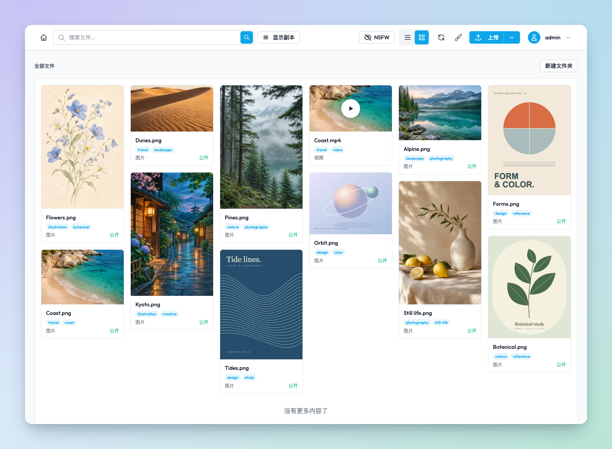
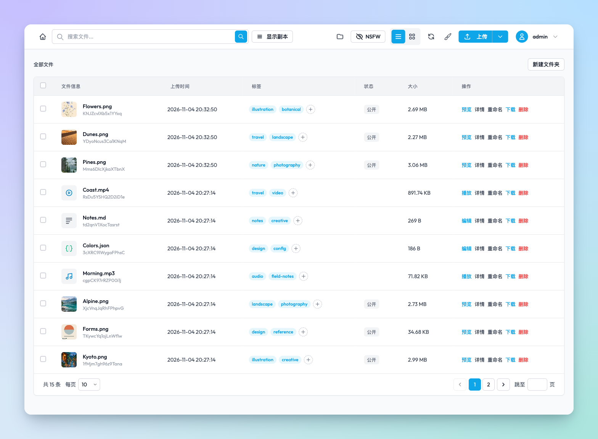
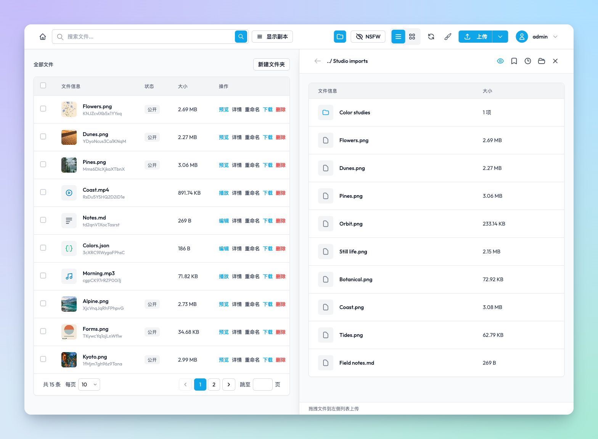

<div align="center">


# BootFS

**自托管的多媒体文件管理与存储。**

浏览、整理和分享你的图片、视频、音频与创作产物。单节点独立运行，也能按需连接其他 BootFS 节点。

[](https://github.com/ginpika/bootfs/actions/workflows/docker-build.yml)
[](#quick-start)
[](./LICENSE)

[English](./README.md) · **简体中文**

[界面预览](#preview) · [为什么需要 BootFS](#why-bootfs) · [动态组网](#nodes) · [功能](#features) · [快速开始](#quick-start) · [文档](#documentation)

</div>

<a id="preview"></a>



<details>
<summary>更多界面预览</summary>

**列表视图。**



**双栏上传。**



</details>

<a id="why-bootfs"></a>

## 你为什么需要 BootFS ？

答案可能在其中之一，我个人只是刚好满足其中的所有原因。

- 你受够了传统分布式文件系统的丑陋 UI，想有一个拥有更现代、交互更出色的界面的文件存储服务，最好还兼容 s3 协议
- 你是一个赛博仓鼠，热衷于收集各种互联网资源，比如图片、视频、音频、模型等，并且喜欢一个人在电脑前欣赏这些艺术
- 你看完了凉宫春日的忧郁，忽然想构建一个站点来无限循环播放漫无止尽的八月
- 你是一个 AIGC 信徒，常年混迹于各种 AI 创作平台，当你不断的精进自己的用提示词摇奖的能力时，你望着自己一大堆 output 陷入了沉思
- 你想试试一款更现代的图床，比如基于 BootFS 的图床，或者基于 BootFS 的视频床
- 出于某种原因，你不想使用公有云大厂提供的网盘，你想要一个自托管的网盘
- 你需要找到一个更全面的数字资产管理软件

<a id="nodes"></a>

## 独立节点与动态组网

每个 BootFS 节点都保存自己的完整文件、元数据和搜索索引。一个应用容器加一个数据卷即可运行，无需外部 etcd 或 MeiliSearch。

- **自己的数据，留在自己的节点。** 文件、标签、描述和索引由持有节点管理，加入组网不会合并其他节点的文件数据库，也不会改写原有资源 UUID。
- **用验证码连接。** 在系统仪表盘生成验证码，另一端填写节点 URL 和验证码即可连接，无需手工交换密钥。
- **一起查找，按需访问。** 联合查询检索可达成员的资源，修改请求转发到实际持有节点；部分节点离线时，列表会提示结果不完整。
- **离开后继续使用。** 退出组网后，本机文件、元数据和索引仍可读写，重启后保持独立，也能再加入其他组网。

默认上传策略是 `single-local`，本机持久保存后即可发布；也可配置完整副本，或选择发布前需要多个节点确认的 `replicated(k)`。组网本身不会自动搬迁所有文件，源节点离线后的读取取决于可达节点是否持有完整副本。详见[动态组网](./docs/mononode-dynamic-cluster.md)与[内核指南](./docs/mononode-kernel.md)。

<a id="features"></a>

## 可以用 BootFS 做什么

| 场景 | 功能 |
| --- | --- |
| **浏览与上传** | 列表、网格和双栏布局，浏览本地目录并挑选文件上传；支持图片、音频和视频预览。 |
| **整理收藏** | 标签、名称、描述与全文检索，按文件夹浏览资源，管理漫画和图包。 |
| **保存 AI 创作** | 读取图片中的 ComfyUI 等生成元数据，查看 prompt、cfg、sampler、steps 等信息。 |
| **编辑文本** | YAML、TXT、TOML、INI、JSON 等文本的内置编辑器，支持行号、缩进、快捷保存及 UTF-8 / GBK 编码，最大 2 MiB；保存后保留 UUID、链接和标签。 |
| **看图与放映** | 随机瀑布流画廊、HLS 个人放送平台和分片 HLS 上传；通过 FFmpeg 生成媒体派生物并处理 WebP / HLS。 |
| **管理 Clash 配置** | 为带 `clash` 标签的 YAML 展示节点信息，检测服务端 TCP 延迟，并转换为 v2rayN 等客户端可用的订阅。 |
| **连接 S3 客户端** | 节点级 S3 兼容接口，支持对象列表、上传、下载、删除、复制及前缀文件夹，使用 SigV4 与 path-style 寻址。 |

Clash 原文与转换订阅沿用资源的读取规则，包含凭证的配置需结合访问权限使用。操作说明见 [Clash 订阅](./docs/clash-subscriptions.md)；S3 客户端设置见下方[登录与 S3](#integrations)。

<a id="quick-start"></a>

## 快速开始

准备 **Git、Docker 和 Docker Compose**。下面从源码构建并启动一个新节点，镜像已包含 Java 17 与 FFmpeg，不需要在宿主机另装媒体处理工具。

```sh
git clone https://github.com/ginpika/bootfs.git
cd bootfs
docker compose up --build -d
```

打开 **[http://localhost:8181](http://localhost:8181)**，远程部署时替换为服务器地址。首页右上角的「设置」（`/settings`）管理当前节点的配置：

1. 设置节点入口地址。跨机器访问或组网时，填写浏览器和其他节点实际可达的地址；入口变更需按页面提示重启。
2. 按使用范围配置登录和公开读取。新安装 **SSO 默认关闭，公开读取默认开启**；需要登录保护时，先配置并测试认证服务，再启用 SSO，并关闭公开读取。
3. 按需开启 S3、调整副本策略或连接其他节点。

默认端口为 **8181**，持久数据位于容器的 **`/data`**，由 Compose 的 `data` 卷保存。新安装还默认不限角色，开启本机直连与内网延迟检测；关闭 SSO 时，共享管理功能也不校验用户身份。

普通业务设置保存在当前节点的数据库中，无需准备 `.env`。可选启动模式见 [`.env.example`](./.env.example)，默认 `BOOTFS_METADATA_MODE=auto`；已初始化的业务设置通过页面修改。已有部署升级前，请先阅读[设置迁移](./docs/node-settings.md#首次升级与优先级)和[内核迁移说明](./docs/mononode-kernel.md)。

<details>
<summary>使用已发布的 AMD64 / ARM64 镜像</summary>

在仓库根目录操作。从 GitHub Actions 发布任务摘要中取得本次修订对应的 `BOOTFS_IMAGE`，用实际完整提交 SHA 替换下方占位符：

```sh
export BOOTFS_IMAGE='ghcr.io/ginpika/bootfs:sha-<完整提交 SHA>'
docker compose -f docker-compose.ghcr.yml up -d
```

此 Compose 文件要求显式指定镜像。GitHub Actions 先运行 JDK 17 测试，再分别验证 AMD64 / ARM64 镜像的启动、FFmpeg、上传下载、搜索与容器重建后的持久化，通过后发布 GHCR 镜像。默认分支的最新提交更新 `latest`，版本标签发布对应版本，每次发布都提供 `sha-<完整提交 SHA>` 标签。

</details>

<a id="integrations"></a>

## 登录与 S3

| 连接方式 | 如何使用 |
| --- | --- |
| **HostID SSO** | 在设置页填写兼容的认证服务地址，例如 [HostID](https://github.com/ginpika/hostid)，测试通过后启用 SSO；可限制允许访问的角色。 |
| **可信本机直连** | 启用 SSO 后，可保留本机回环连接免登录。Docker 网关、内网地址和经代理转发的请求不适用此规则，见[本机访问说明](./docs/local-access.md)。 |
| **S3 客户端** | 在设置页创建并保存访问凭据，再启用 S3。Endpoint 为 `https://<节点域名>/s3`，默认桶为 `bootfs`，使用独立的 SigV4 凭据。 |

S3 的 bucket/key 属于接收请求的节点，组网不会形成全局统一的 S3 命名空间。目前不提供 multipart 上传、对象版本管理等完整 S3 能力。Cyberduck 可导入 [BootFS 连接配置](./docs/clients/BootFS.cyberduckprofile)；连接步骤和反向代理要求见[节点设置](./docs/node-settings.md#s3-客户端连接)。

## 备份与升级

**备份完整的数据根目录，并保留设置库、保护密钥和节点身份。** 为同节点恢复制作备份时，先停机，再备份整个 `/data`，包括文件、元数据、`kernel/settings`、`kernel/security`、`kernel/cluster` 和根目录下的 `uuid`；设置数据库必须与对应的 `kernel/security/settings.key` 一起保留。

跨节点迁移和旧 Raft 数据恢复使用[离线备份、校验与恢复工具](./docs/mononode-backup.md)。便携备份不包含 S3 凭据、节点安全身份等部署状态，恢复后需重新配置；不能仅凭文件清单恢复完整元数据。

源码 Compose 部署先完成备份，再在原部署目录更新：

```sh
git pull --ff-only
docker compose up --build -d
```

使用发布镜像时，更新 `BOOTFS_IMAGE` 后运行：

```sh
docker compose -f docker-compose.ghcr.yml pull
docker compose -f docker-compose.ghcr.yml up -d
```

保持相同的 Compose 项目与数据卷。**不要用 `docker compose down -v` 升级，它会删除数据卷。** 旧外置中间件或共享 Raft 部署先按[内核指南](./docs/mononode-kernel.md)确认迁移路径。

## 技术栈与本地开发

**Spring Boot + Java 17**，**RocksDB** 保存本机元数据，**Lucene** 提供本地搜索，**FFmpeg** 处理媒体，前端使用 **Thymeleaf + Tailwind CSS**。Apache Ratis 保留用于旧 Raft 模式兼容，当前默认组网不依赖全局 Raft 共识。

<details>
<summary>从源码开发与检查</summary>

安装 **JDK 17、系统 Maven 和 FFmpeg**，在仓库根目录运行：

```sh
./dev.sh
# 传入额外 Maven 参数，例如更换端口：
./dev.sh -Dspring-boot.run.arguments=--server.port=8282
```

脚本为 Maven 和应用选择同一 JDK 17，并启用 `dev` profile。直接使用 Maven 时，先将 `JAVA_HOME` 指向 JDK 17，再用 `mvn -version` 确认；Java 8 无法运行，较新 JDK 可能与当前 Lombok 注解处理器不兼容。

```sh
mvn test
mvn package -DskipTests
java -jar target/bootfs-v1.0.0-beta.1.jar --spring.profiles.active=dev
```

本地开发的数据根目录、媒体依赖与配置说明见[内核指南](./docs/mononode-kernel.md)。

</details>

<a id="documentation"></a>

## 文档

| 你正在做的事 | 从这里开始 |
| --- | --- |
| 配置节点、登录、公开读取或 S3 | [节点设置与升级](./docs/node-settings.md) |
| 理解本机数据、上传策略和当前边界 | [本地内核](./docs/mononode-kernel.md) |
| 部署多个节点 | [集群部署](./docs/cluster-deploy.md) |
| 配对、退出组网或查询远端资源 | [自治节点与动态组网](./docs/mononode-dynamic-cluster.md) |
| 备份、校验、恢复或迁移旧数据 | [备份与恢复](./docs/mononode-backup.md) |
| 配置仪表盘与反向代理 | [系统仪表盘](./docs/dashboard.md) |
| 使用本机免登录与命令行写请求 | [本机访问](./docs/local-access.md) |
| 管理 Clash 配置与订阅 | [Clash 订阅](./docs/clash-subscriptions.md) |
| 了解认证、分享与接口访问边界 | [安全审查报告](./docs/security-audit.md) |
| 调整界面与交互 | [设计系统](./docs/design-system.md) |

BootFS 采用 [GNU AGPL v3](./LICENSE) 许可证。
