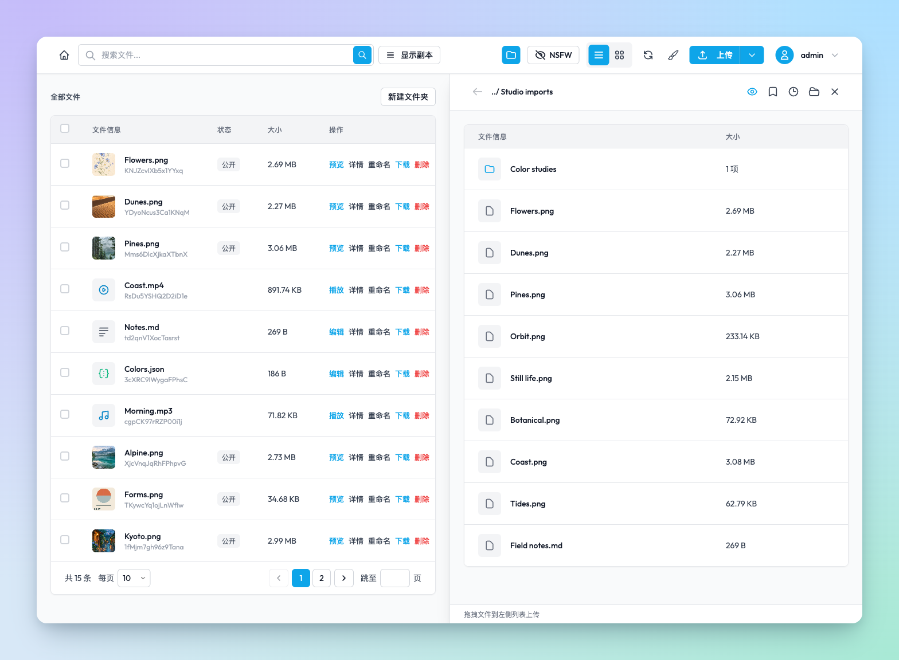
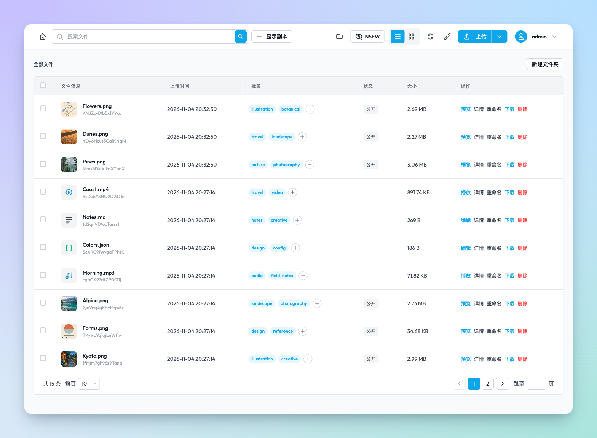
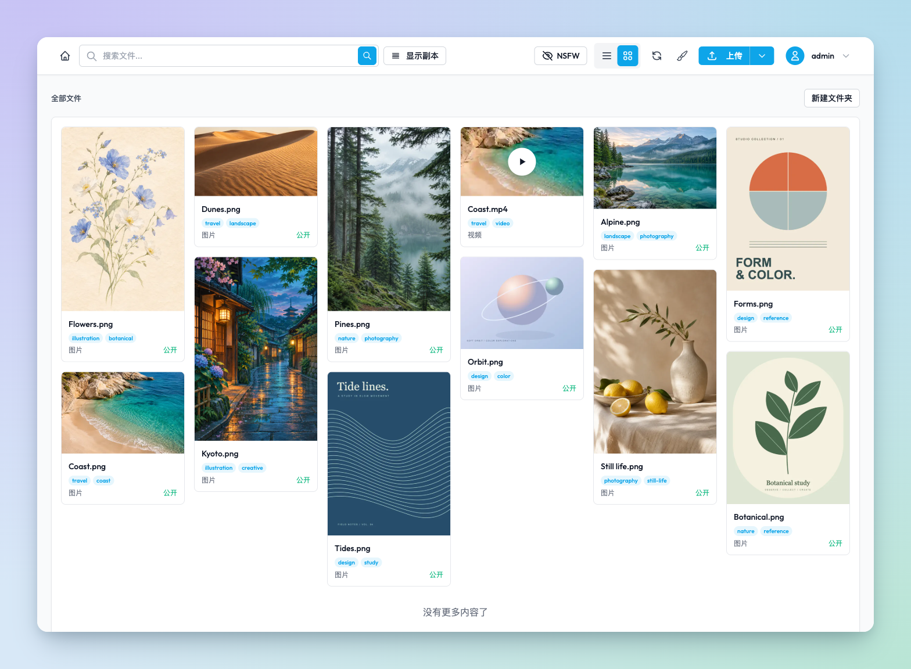
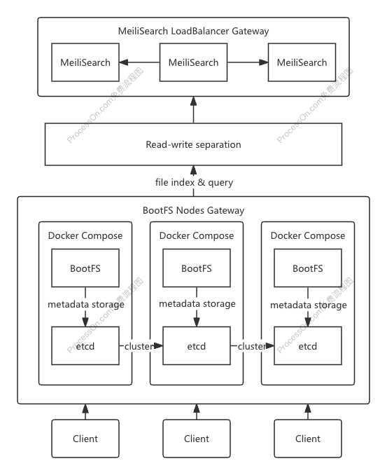

# BootFS

[English](./README-en.md)

当前分支正在演进为内置 mononode：RocksDB + Apache Ratis + Lucene。运行、旧数据迁移和实现边界请先阅读 [内核指南](./docs/mononode-kernel.md)。

<details>
  <summary>界面预览</summary>
  
  
  
</details>

一个轻量级 & 专注于多媒体文件的文件管理系统，基于 Spring Boot & FFmpeg。

## 你为什么需要 BootFS ？

答案可能在其中之一，我个人只是刚好满足其中的所有原因。

- 你受够了传统分布式文件系统的丑陋 UI，想有一个拥有更现代、交互更出色的界面的文件存储服务，最好还兼容 s3 协议
- 你是一个赛博仓鼠，热衷于收集各种互联网资源，比如图片、视频、音频、模型等，并且喜欢一个人在电脑前欣赏这些艺术
- 你看完了凉宫春日的忧郁，忽然想构建一个站点来无限循环播放漫无止尽的八月
- 你是一个 AIGC 信徒，常年混迹于各种 AI 创作平台，当你不断的精进自己的用提示词摇奖的能力时，你望着自己一大堆 output 陷入了沉思
- 你想试试一款更现代的图床，比如基于 BootFS 的图床，或者基于 BootFS 的视频床
- 出于某种原因，你不想使用公有云大厂提供的网盘，你想要一个自托管的网盘
- 你需要找到一个更全面的数字资产管理软件

## 架构



上图保留设计沿革。当前内置内核与集群部署见 [mononode-kernel.md](./docs/mononode-kernel.md) 和 [cluster-deploy.md](./docs/cluster-deploy.md)。

采用去中心化对等边缘存储架构 (Decentralized Peer-to-Peer Edge Storage Architecture)

## 特性

- 优秀的列表 / 网格模式下的音视频预览能力，支持多种格式的详情/文件描述预览
- 列表模式为 YAML、TXT、TOML、INI、JSON 等配置与文本文件显示专用图标，支持内置编辑器（行号、缩进、快捷保存，UTF-8 / GBK，最大 2 MiB）；可自动识别或手动选择读取编码，保存保留原编码、UUID、访问链接及标签等元数据
- 带 `clash` 标签的 YAML 显示小猫图标，详情支持节点地址与服务端 TCP 延迟检测，`/p/<uuid>?p=vless` 可导出所有可转换节点的 v2rayN 订阅，见 [Clash 订阅说明](./docs/clash-subscriptions.md)
- 经典的双栏布局，更好的挑选将某个本地路径下的图片文件并上传
- 基于 tag 的分类管理，方便用户组织自己的资源
- 图片支持 ComfyUI 格式的关键元数据，比如 prompt、cfg、sample、steps 等
- 基于 Tailwind CSS 精心设计 UI/UX 的资源管理界面，优秀的预览能力
- 内置了一个 hls 流个人放送平台，并且可以碎片化的上传 hls 流文件，在线上与朋友共同欣赏大片
- 内置了一个酷炫的瀑布流随机画廊
- 通过 FFmpeg 实现了 webp 编解码以及 hls 转码能力
- 内嵌本机 RocksDB 元数据和 Lucene 索引，完整文件与元数据同节点保存；验证码组网，退群后继续独立使用

Build with：Spring Boot + RocksDB + Apache Ratis + Lucene + FFmpeg

## 开发

使用 JDK 17 和系统 Maven。媒体处理需要 FFmpeg。

本地开发启动（自动查找 JDK 17，避免系统 Java 与 Maven 使用不同版本）：

```shell
./dev.sh
# 额外 Maven 参数示例：
./dev.sh -Dspring-boot.run.arguments=--server.port=8282
```

若直接使用 `mvn spring-boot:run`，请先将 `JAVA_HOME` 指向 JDK 17，并用 `mvn -version` 确认。Java 8 无法运行本项目，较新 JDK 可能与当前 Lombok 注解处理器不兼容（如 `TypeTag :: UNKNOWN`）。macOS Homebrew 安装的 JDK 17 可这样使用：

```shell
export JAVA_HOME="$(brew --prefix openjdk@17)/libexec/openjdk.jdk/Contents/Home"
export PATH="$JAVA_HOME/bin:$PATH"
mvn spring-boot:run -Dspring-boot.run.profiles=dev
```

手动构建和运行也需使用同一 JDK 17：

```shell
mvn test
mvn package -DskipTests
java -jar target/bootfs-v1.0.0-beta.1.jar --spring.profiles.active=dev
```

开发配置默认关闭 SSO。旧数据目录需要显式迁移，不能直接将本地文件清单当作外部搜索元数据的完整备份。

## 部署

```shell
cp .env.example .env
# 配置站点入口、SSO 和可选 S3 凭据
docker compose up --build -d
```

运行时只需要 BootFS 容器与数据卷。单节点、三节点、存储副本保证和迁移步骤见 [内核指南](./docs/mononode-kernel.md)；集群配置见 [集群部署](./docs/cluster-deploy.md)。

GitHub Actions 先运行 JDK 17 测试，再并行构建 amd64 / arm64 镜像。两个架构都通过容器启动、FFmpeg、文件上传下载、搜索和容器重建后的持久化检查后，才合并并发布 GHCR 镜像。PR 仅验证；默认分支的最新提交更新 `latest`，版本标签发布对应版本，所有发布均提供 `sha-<完整提交 SHA>` 标签。

使用发布任务摘要中的 `BOOTFS_IMAGE=ghcr.io/ginpika/bootfs:sha-<完整提交 SHA>` 配合 `docker compose -f docker-compose.ghcr.yml up -d` 部署指定提交。手动运行工作流时仍可勾选禁用 Docker 缓存。

## 开发计划（优先度从上到下）

- 现有功能的 debug & 修复
- i18n 支持，引入 English 翻译
- 系统仪表盘的优化 & 修复工作
- s3 协议在集群环境下的支持
- 支持 3D 模型的预览和详情
- 去中心化P2P节点握手
- Query 接口的优化
- Controller 层整理

### 动态组网、内容耐久性与恢复

新节点和已有本地 embedded 数据默认使用自治本地内核。在目标节点的系统仪表盘生成验证码，在另一端填写 URL 和验证码即可组网，无需手动配置密钥。组网不合并文件元数据库，不改写资源 UUID；联合查询和远端修改访问实际持有节点。退出后本机文件、元数据、索引继续读写，之后可加入其他集群。上传可选择 `single-local` 或 `replicated(k)`；完整副本携带必要元数据，原节点离线后仍可读取。旧共享 Raft 数据保留备份恢复路径。

- [动态组网与版本](docs/mononode-dynamic-cluster.md)
- [完整内核备份恢复](docs/mononode-backup.md)
- [配置、故障语义及当前边界](docs/mononode-kernel.md)
