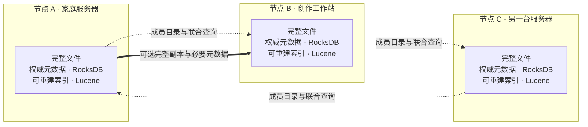

# 去中心化设计

[English](./decentralization.md) · **简体中文** · [返回 README](../README-zh-CN.md)

BootFS 的去中心化设计以**自治节点组成的联邦**为基础：每个节点都是完整的文件服务，保存自己的文件和元数据，并决定与哪些节点建立连接。一个节点可以独立使用，也可以参与联合查询和完整副本协作。

这里的去中心化，指的是**数据权威归属于各个节点，本机服务可以独立运行**。组网让独立服务互相协作；成员目录的协调、文件归属和副本保存分别承担不同职责。

## 先有完整的节点，再建立协作

在家庭服务器上整理收藏、在工作站上保存创作产物，通常并不需要让两台机器共同维护一份全局数据库。BootFS 让它们各自管理自己的资源，在需要时连接起来：

- **本机拥有完整的数据。** 原始文件与名称、标签、描述等权威元数据保存在同一个节点，本地搜索索引可以由元数据重建。
- **协作范围由你选择。** 用明确的节点地址和短时验证码配对；服务的运行不需要 BootFS 运营方提供组网中心。
- **节点有独立的生命周期。** 可以分别启动、停机备份、离开组网，之后加入其他组网；已有本机资源身份保持不变。
- **保存几份是明确的策略。** 组网、联合查询和文件复制分别工作，上传策略决定何时完成发布。

图中的虚线表示组内查询协作，跨节点实线表示可选的副本传输。图中仅画出部分请求方向；任一成员都可以发起联合查询。每个节点保留自己的数据边界，加入组网不会合并文件数据库或索引。

## 核心概念

| 概念 | 在 BootFS 中的含义 |
| --- | --- |
| **节点** | 一份独立的 BootFS 实例及其数据根目录，包含文件、权威元数据、索引、设置和安全身份。 |
| **节点 ID** | 数据根目录中 `uuid` 保存的稳定存储节点身份。离开组网后保留；不要复制同一份身份目录来运行两台不同节点。 |
| **资源 UUID** | 一个资源在持有节点上的身份。定位资源需要结合持有节点入口与资源 UUID；它与节点 ID 职责不同。 |
| **权威元数据** | 文件清单、名称、标签、描述、关系和版本等持久状态，由本机 RocksDB 管理。修改交给持有资源的节点。 |
| **搜索索引** | 从本机元数据生成的 Lucene 检索视图，可以重建。联合查询临时汇集其他节点的结果。 |
| **组网** | 一组显式建立信任关系的节点，保存成员目录，协作查询、转发请求和传输副本。 |
| **完整副本** | 完整文件及必要元数据的本机快照，具有接收节点自己的资源 UUID，并记录来源关系。 |
| **成员协调节点** | 串行处理成员目录变更的角色。文件元数据仍由各个持有节点管理。 |

## 从独立使用到协作，再回到独立

假设 A 保存旅行照片，B 保存设计稿，C 是另一组中的节点。

1. **A 独立使用。** 上传、打标签和本地搜索均由 A 完成。默认 `single-local` 策略在本机持久保存后即可发布。
2. **A 与 B 配对。** 从 A 发起联合查询，可以看到可达的 B 的资源；B 的文件仍保存在 B。对 B 资源的重命名、标签或删除请求转发给 B 处理。
3. **按需为 A 的照片制作 B 上的副本。** B 保存完整字节和必要元数据，收到发布确认后建立本机可读的副本。这个副本有自己的 UUID，`copyOf` 与来源快照记录它来自哪里。
4. **A 离开组网。** A 保留本机文件、资源 UUID、节点 ID 和本地索引，建立独立的组网身份并撤销旧成员的本机访问授权。重启后保持独立，之后可以用 C 的验证码加入 C 所在组网。

如果 B 已经持有发布完成的完整副本，即使 A 离线，B 也能通过自己的副本身份提供读取。原来指向 A 的公开 URL 仍依赖 A 的入口；副本可读不代表旧域名或链接会自动转到 B。

## 上传策略决定文件怎样保存

| 策略 | 何时可以发布 | 对其他节点的依赖 |
| --- | --- | --- |
| **`single-local`（默认）** | 本机完整文件与必要元数据耐久保存后。 | 发布不等待其他节点；配置副本份数后可在后台制作完整副本。 |
| **`replicated(k)`** | 包含本机在内的 k 个不同节点确认完整字节和准备元数据已耐久保存后，源节点才能提交发布。k 至少为 2。 | 可达节点或确认份数不足时，上传可能等待或返回待完成状态；离开组网不会自动降低已选择的 k。 |

源节点发布后，还会通知接收端发布副本，并持久重试未完成的通知。因此，耐久确认与所有副本立即可见是不同阶段。

同组且源节点可达时，副本会跟随源资源的元数据和删除记录；源节点不可达时保留最后完整快照。在本机编辑副本的名称、标签或公开状态，会先将它标记为独立分支，后续源同步不会覆盖这些本机修改。

**副本和备份承担不同职责。** 同组副本可能跟随源删除，独立备份用于保留可恢复的历史状态。各节点可以分别停机备份，无需让新组网内的数据库处于同一版本。

## 遇到离线或成员变化时

| 情况 | 当前行为 |
| --- | --- |
| **某个成员不可达** | 本机读取、元数据修改和本地索引继续工作；新上传是否能发布取决于所选策略。 |
| **联合查询遇到离线成员** | 返回可达部分，并通过 `partial`、`unavailableNodes` 和界面提示表明结果不完整。`meta:local` 可只查询本机。 |
| **远端资源需要修改** | 请求交给持有节点；持有节点不可达时，当前节点不能代替它确认修改成功。 |
| **源节点离线** | 已发布的完整副本可以独立读取；仅知道文件位于哪里，并不能提供其文件字节。 |
| **成员协调节点突然离线** | 新增成员需等待协调节点恢复。本机操作、对可达成员的查询以及本地退出仍可继续；当前没有自动选举新的协调节点。 |
| **协调节点正常退出** | 将成员目录职责移交给剩余 nodeId 最小的节点。 |
| **本机主动退出** | 立即持久保存独立组网状态并撤销旧组的本机访问授权，向其他成员传播退出通知；已经持有的完整副本继续保留。 |
| **管理员移除另一节点** | 协调节点更新成员目录并异步传播。被移除节点在收到相应更新后重建独立组网状态，离线时存在传播延迟。 |

成员协调节点负责组网目录，本机文件的读写不需要获得组内多数派批准。显式选择 `replicated(k)` 的上传仍需满足自己的副本条件。

## 信任、登录和命名空间

**配对建立节点之间的信任。** 节点身份、签名密钥和逐节点传输授权由程序生成并保存；对等请求使用签名校验。连接时要提供双方可达的 HTTP/HTTPS 地址，首次验证码交换应使用可信地址和传输通道。当前不提供自动公网发现或 NAT 穿透。

**SSO 管理用户对节点的访问。** 登录、允许的角色、公开读取与 S3 凭据由各节点独立配置。组网不会自动统一这些设置；节点通信也不靠转发浏览器 Cookie 来获得身份。共享应用的角色限制不建立用户之间的数据隔离。

**S3 的 bucket/key 属于接收请求的节点。** A 和 B 可以各有自己的同名 key，组网不会自动合并成统一的对象空间。资源通过节点入口和 UUID 访问；SHA-256 用于完整性校验，不是当前公开资源的寻址方式。

退出组网或撤销授权会停止后续协作，但不会远程擦除对方已经保存的文件。需要控制资源读取时，应同时设置相关节点上的访问权限。

## 这些选择带来的取舍

BootFS 将本机数据的可用性放在节点自身：普通本地读写不依赖全局文件数据库，也不因成员协调暂时不可用而停止。代价是跨节点视图反映各节点各自的状态，联合分页按节点分组，不提供全局事务、同一时刻的查询快照或统一相关性排名。

文件的容量和可达性也由实际持有节点决定。组网不会自动搬迁全部文件或再均衡存储；需要在其他节点离线后继续读取某份内容，就应提前配置并确认完整副本。大库联合查询、持续负载与硬件掉电耐久性仍需在目标环境中验证。

当前默认实现使用本机 RocksDB 和 Lucene。Apache Ratis 保留用于旧共享 Raft 模式兼容；旧架构图和历史方案中的全局文件共识不描述这里的自治节点模型。

## 继续阅读

| 你想了解的内容 | 文档 |
| --- | --- |
| 本机存储、发布过程与当前实现边界 | [本地内核](./mononode-kernel.md) |
| 配对、退出与成员协议 | [自治节点与动态组网](./mononode-dynamic-cluster.md) |
| 启动多个节点并连接起来 | [集群部署](./cluster-deploy.md) |
| 登录、公开读取、S3 与副本设置 | [节点设置与升级](./node-settings.md) |
| 备份、恢复和旧数据迁移 | [备份与恢复](./mononode-backup.md) |
| 接口与访问控制边界 | [安全审查报告](./security-audit.md) |
