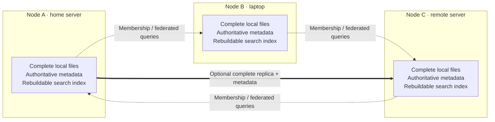

# Decentralized design

**English** · [简体中文](./decentralization-zh-CN.md) · [Back to the README](../README.md)

BootFS connects autonomous file services: each node keeps authority over its own files and metadata, while cooperating with other nodes for discovery, access and optional replication.

## Start with an independent node

A single BootFS node is a complete application. It stores whole files, manages their names, tags and descriptions, and builds its own search index. It can serve a collection without joining a group or running an external metadata or search service.

This makes a personal computer, a home server and a remote server useful on their own. Connecting them adds a shared way to find and access resources. Each operator keeps the local collection and can change which group the node belongs to.

**Decentralization in BootFS means local data authority and independent operation.** The current default model has no shared global file database or required BootFS-operated hub. Some coordination still exists for group membership, with a narrower role than storing or approving every file operation.

## A group connects services, not databases

The dotted paths represent cooperation between independent services. They do not copy every member's database into every other node. The thick path illustrates a separately configured replica transfer; joining a group alone does not create it.

Nodes pair through an explicit HTTP/HTTPS URL and a short-lived verification code. The group maintains a member directory so nodes know which peers they can contact. Current networking expects reachable peer addresses; it does not provide automatic public discovery or NAT traversal.

## The core concepts

| Concept | Meaning |
| --- | --- |
| **Node** | A complete BootFS instance with its own storage root, stable node identity and reachable service URL. |
| **Resource** | A file or collection managed by a node, identified by a resource UUID. A resource UUID and a node ID identify different things. |
| **Authoritative metadata** | The local records that define resources: names, tags, descriptions, relationships, versions, deletion state and protocol bindings. |
| **Search index** | A local, rebuildable view of resources held by the node. User-authored metadata survives rebuilding the index. |
| **Group** | A set of connected nodes with membership and peer-access relationships. Membership does not transfer ownership of local resource databases. |
| **Replica** | A complete local copy with the metadata needed to read it independently, its own resource UUID and a `copyOf` link to its source. |
| **Membership coordinator** | The member that serializes changes to the group directory. It does not own the other members' files or approve their ordinary local writes. |

A node's stable ID is stored in the root-level `uuid` file and survives leaving a group. Its group identity and peer authorizations can change without renaming its existing resources. Copying an identity directory to run two active nodes would duplicate that identity; each deployment needs its own root.

## Search together; modify at the holding node

Suppose a photograph lives on node A and you open BootFS on node B. A federated query from B can find the photograph by asking A. The result stays a reference to A's resource: it is not imported into B's authoritative database or local index.

A rename, tag change or deletion of that resource is sent to A. If A is unavailable, B does not invent a successful change or write a competing authoritative version on its behalf. B can still work with its own local resources.

The result list reports unreachable members through `partial` and `unavailableNodes`. Searching with `meta:local` asks only the current node. Federated pagination groups results by node and then uses local ordering; the combined list is not a global snapshot or a single relevance ranking.

Resource links retain the holding node's URL and the resource UUID. A replica can preserve access to the content through its own local identity; it does not automatically take over an unreachable source URL.

SHA-256 is used to verify content integrity; public resource addressing currently uses the node URL and resource UUID.

## Choose when another node must hold the file

The write policy determines when an upload can be published:

| Policy | Publication condition | What this means offline |
| --- | --- | --- |
| **`single-local`** | The complete file and its metadata are durable on the receiving node. This is the default. | Local publication does not need a reachable peer; configured background replicas may follow later. |
| **`replicated(k)`** | At least `k` distinct nodes, including the receiving node, acknowledge durable file bytes and preparation metadata before publication. The minimum is two. | Too few reachable nodes can delay or prevent completion. Leaving a group does not lower an upload's already selected requirement. |

A complete replica carries more than file bytes. It retains the source's descriptive metadata and provenance, so an already published replica can be read even when the source is offline. A prepared transfer becomes locally published after the source confirms publication; preparation alone is not a completed, readable resource.

While source and replica remain connected in the same group, the replica follows source metadata and deletions. During a disconnection it keeps the last complete snapshot. Editing the replica's name, tags or public state locally first creates an independent branch, so later source synchronization does not overwrite those edits.

This gives a local copy a clear identity and history. BootFS does not automatically merge arbitrary edits from multiple nodes into one shared resource history. A source S3 binding is preserved as provenance rather than taking over an existing key on the receiving node.

## Connect, leave and reconnect with the same collection

Consider a laptop B that already has its own collection:

1. **Independent.** B uploads, edits and searches its local resources using its own database.
2. **Connected to A.** B pairs with a home server A. Both can query reachable resources across the group, while each retains its existing files, metadata and UUIDs.
3. **Optional copies.** If a replica policy creates a complete, published copy of an A resource on B, B can read that local copy without A being online.
4. **Independent again.** B leaves. Its local collection, including complete copies it already holds, remains usable after restart. B stops accepting synchronization from the old group.
5. **Connected to C.** B can join another group through a new pairing. It does not need to clear its collection or merge it into C's database first.

Leaving immediately revokes the old group's local access authorization. Departure notifications to offline peers are retried, so their view of membership can lag. Leaving does not erase complete copies already held by another member.

## What changes when a node is unavailable?

The table assumes functioning local storage and the normal authentication requirements for each operation.

| Situation | Expected behavior |
| --- | --- |
| A peer is unreachable | Local reads, metadata changes and local search continue; federated results identify the missing part. |
| An upload uses `single-local` | It can publish after local durability, without a peer acknowledgement. |
| An upload cannot meet `replicated(k)` | It may wait or report that publication is pending. A timeout is not proof of successful publication. |
| The only node holding a file is offline | Other nodes cannot serve bytes that they do not hold. A reachable, published complete replica can serve its own local copy. |
| The membership coordinator disappears unexpectedly | Existing local work, queries to reachable peers and local departure continue. New joins wait for the coordinator to recover. |
| The coordinator leaves normally | It hands the directory role to the remaining member with the smallest node ID. |
| A node leaves and restarts | It remains independent; it does not automatically rejoin its former group. |
| An administrator removes another member | The coordinator updates the directory and propagates the change. The removed node resets its group state after receiving the update; offline members can learn of the change later. |

The membership role is deliberately separate from resource authority. There is currently no automatic election after an unexpected coordinator failure. Ordinary local reads and writes do not require a group-wide majority; an upload using `replicated(k)` must still meet its own replica requirement.

## Peer trust, user sign-in and protocol namespaces

Pairing establishes an intentional trust relationship between deployments. Nodes generate and exchange their own identities and peer credentials, then authenticate peer requests. This is a group of explicitly connected services, rather than anonymous participation in a public storage network.

User sign-in is a separate concern. Each node keeps its own SSO, allowed-role, public-read and S3 settings. Pairing does not create shared browser sessions or copy those settings to every member. For example, choosing HostID as an SSO service is an operator decision; the storage model does not require a particular shared account provider.

S3 clients connect to a specific node. Its bucket/key bindings remain local even when the browser can search across a group. The group does not create one global S3 namespace, cross-node key uniqueness or distributed transactions.

See [node settings](./node-settings.md) and the [security audit](./security-audit.md) for the actual access rules. In particular, the current public-read switch and gallery inclusion flags do not amount to a complete per-file access-control system.

## Replication and backup serve different purposes

Replication keeps another usable copy close to a service, but connected replicas can follow source deletions. A separately retained backup preserves a recovery point. Each autonomous node can be backed up independently during its own maintenance window; new groups do not need every database to share one global revision.

For recovery of the same deployment, preserve the data root together with its settings keys and node identity. Portable logical restoration preserves resource UUIDs and creates new group identity without reusing old member authorizations or signing credentials. SSO and S3 start disabled after portable restoration; configure deployment credentials before enabling them again. Follow the [backup and restore guide](./mononode-backup.md) rather than treating a file inventory or another member's database as a complete backup.

## Where this design fits

BootFS prioritizes collections that remain useful independently: a home library connected to a laptop, several servers sharing a searchable view, or operators who want to leave a group while keeping their local data. Cooperation grows from those complete services.

The tradeoff is that a group is not presented as one globally consistent disk. It does not automatically rebalance every file, provide a unified query snapshot, merge competing histories or transfer an offline node's URLs to another server. Replica placement and reachable service addresses remain explicit operational choices. Large-library scale, sustained load and hardware power-loss durability still need validation in the target environment.

These concepts describe the current autonomous-node model. Historical shared-Raft designs retained for migration and compatibility have different availability rules and should not be used to infer the behavior of a new group.

## Continue reading

- [Dynamic networking](./mononode-dynamic-cluster.md): pairing, departure, peer authorization and replica behavior.
- [Local kernel](./mononode-kernel.md): authoritative storage, publication and indexing boundaries.
- [Current cluster deployment](./cluster-deploy.md): connecting actual instances (Chinese).
- [Node settings](./node-settings.md): authentication, S3 and per-node configuration.
- [Backup and restore](./mononode-backup.md): retaining a recovery point and migrating legacy data.
