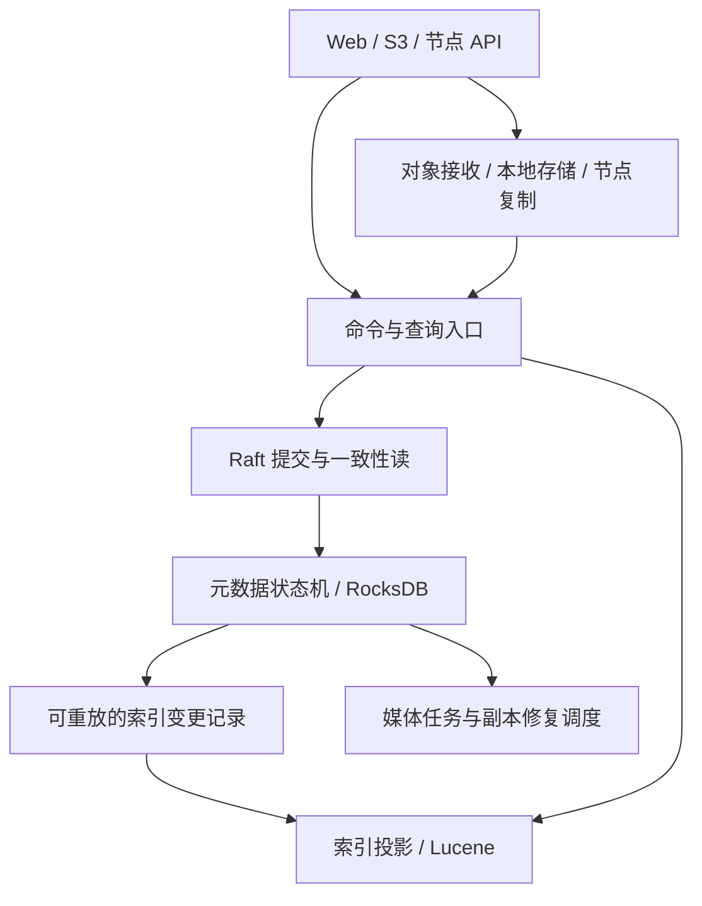

# BootFS mononode 下一阶段架构方案

状态：以下为第一代共享 Raft 方案的历史设计记录，已被自治节点模型取代。当前实现以 [本地内核](mononode-kernel.md) 和 [动态组网](mononode-dynamic-cluster.md) 为准；不要再依据本文把文件元数据接入全局 Raft。

实施进展（2026-10-31）：已接入内置 RocksDB/Ratis/Lucene 第一代内核、统一 S3 生命周期及迁移工具。本轮另接入同步副本准备、离线内核备份恢复，以及用户确认的动态发现/带版本合并/成员加入退出（不重分布对象）。实际运行方式与尚未实现的边界以 [mononode-kernel.md](mononode-kernel.md) 为准。实现选择 Java 17 + Lucene 9.12.3，将运行时升级留作独立变更。

## 1. 目标与实施边界

每个 mononode 运行同一个 BootFS 程序，内置对象存储、Raft 元数据状态机、本地索引引擎和节点通信。单节点可以独立运行；通过显式加入协议，多个节点组成集群。部署时无需独立运行 etcd 或 MeiliSearch。

第一代目标是替代 BootFS 实际使用的中间件能力。对象存储、分布式检索和共识协调是能力方向；完整 S3、Elasticsearch DSL、Redis 命令或 etcd API 兼容不属于第一代验收范围。

保留已有资源 UUID、访问入口、漫画/相册关系、标签和媒体体验。实现过程中保持现有后端可用，逐步接入新内核。

## 2. 推荐的实现基础

| 职责 | 推荐组件 | BootFS 自身需要负责的部分 |
| --- | --- | --- |
| 共识协议 | 嵌入式 Apache Ratis | 命令协议、状态机、成员管理、幂等、读一致性、快照安装 |
| 本地元数据存储 | 嵌入式 RocksDB | 键空间、原子批次、应用进度、持久化配置、快照与恢复 |
| 本地检索 | 嵌入式 Apache Lucene | 文档投影、分析器、标签/排序、查询 API、索引版本和重建 |
| 对象内容 | 现有文件存储逐步演进 | 临时文件、校验和、原子发布、复制、修复和回收 |

以上组件作为程序依赖运行。BootFS 掌握业务状态及分布式协议的组合方式。

Ratis 的 Raft 日志与 RocksDB 的状态机数据职责不同，不能把 RocksDB 当成共识协议。首版保留明确的持久化配置，不提前通过关闭 WAL 等方式优化。

版本在原型阶段根据兼容性和维护状态锁定。当前项目为 Java 17 / Spring Boot 2.7.18；Lucene 10 要求 Java 21。建议新内核目标运行时采用 Java 21，但先单独验证现有应用及依赖兼容性，运行时/框架升级独立提交，避免与数据迁移混在一起。RocksDB JNI 需要验证 macOS ARM64、Linux ARM64 和 AMD64 的打包、加载与关闭行为。

## 3. 单节点内部结构

每个节点都有这些模块。集群角色由运行状态决定，部署程序保持一致。

建议新增独立包 `kernel.metadata`、`kernel.consensus`、`kernel.search`、`kernel.object`、`kernel.cluster`、`kernel.projection`，初期保持单个构建产物，不急于拆多个 Maven 模块。

## 4. 权威状态与派生索引

### 4.1 共识层管理的权威状态

- 资源身份、版本、名称、标签、作者、描述、权限、创建时间。
- 漫画/相册的父子关系与有序资源列表。
- 对象内容版本、长度、校验和、确认过的副本位置及生命周期状态。
- bucket/key 到资源的映射、覆盖版本和删除墓碑。
- 集群身份、成员配置、索引 schema 版本；未来包含分片归属。
- 后续需要跨节点恢复的媒体任务意图和结果。

作者、描述、漫画编排等当前可能只存在于搜索文档中的信息，也必须迁入权威状态，才能做到删除整个索引后完整重建。

本机文件绝对路径、缓存、临时文件、瞬时负载等保存在本地状态中。持久副本身份使用 nodeId + objectId + contentVersion，不使用机器绝对路径。

### 4.2 派生索引

全文倒排、标签过滤、排序字段、漫画浏览视图、聚合等由权威状态生成。索引可以损坏、落后和重建；用户原创信息不能只存在于索引。

先建设一个统一资源索引，以资源类型和字段区分普通文件、漫画、相册、视频等，再按测量结果引入专用索引。

## 5. 变更协议与同步时序

1. 命令包含 requestId、对象预期版本和协议版本；UUID、时间等非确定值由命令发起方生成并写入命令。
2. 任意节点接收请求并转发到对应 Raft leader。成员变化使用共识库的安全成员变更机制。
3. 已提交命令由确定性状态机应用。一个 RocksDB 原子批次更新资源、版本、幂等结果、索引变更记录和 lastApplied。
4. 索引器按顺序消费变更，根据资源 ID 执行幂等 upsert/delete；删除带版本与墓碑，防止旧事件恢复已删除资源。
5. Lucene 的持久提交保存投影进度；重启从已持久提交的进度重放，不能采用超前的外部游标。搜索刷新进度与持久进度分别记录。

状态机应用过程中不执行 FFmpeg、HTTP 或文件大对象传输。外部动作由任务执行器完成，结果通过新命令写回。

索引变更记录和 Raft 日志分别管理保留周期。不能依赖永不截断的 Raft 日志来恢复所有索引：落后超过保留窗口时，从带版本边界的元数据快照重建，再追上增量。快照生成、索引重建和增量回收之间需要明确的保留屏障。

### 读一致性

- **权威元数据读取**：默认通过共识库支持的一致性读机制确认读屏障，再等待对应状态应用；本地读取作为显式允许陈旧的选项。
- **普通搜索**：默认读取本地已刷新的索引，返回 visibleRevision。
- **写后搜索**：写接口返回 revision，搜索支持 minRevision 和超时，等待本节点索引可见进度；超时明确返回未追上状态。
- minRevision 提供“至少包含此前写入”的屏障，不代表整个结果集就是该 revision 的历史快照。
- 分片阶段，进度变成分片版本集合，不能继续用一个全局数字假装所有分片同时可见。

同步延迟通过批量应用和批量索引优化。具体 P95/P99 目标由基准测试确定，不能在网络分区或慢盘下承诺固定同步上限。

## 6. 对象内容与元数据提交

Raft 元数据成功不代表文件内容已具备期望的耐久性，两者需要配合。

建议上传流程：

1. 上传至暂存区，计算内容校验和，生成唯一 uploadId/contentVersion。
2. 按明确的写入策略完成本地及目标节点的持久化和校验。节点确认必须对应具体内容版本；临时副本在提交结果明确前不能擅自回收。
3. 提交发布命令，登记确认的副本并将资源设为 READY。若目标策略不能满足，则返回明确失败或 PENDING，不能返回含糊的完成状态。
4. 返回对象版本、元数据 revision 和已满足的耐久性策略。

首版提供 single-local 和 replicated(k) 两种清晰策略，不把副本数等同于 Raft 多数派。复制节点必须去重并跨真实故障域选择；不满足策略时明确拒绝或等待。

删除先提交墓碑，再异步清理内容与索引；暂存文件和孤儿副本在核对权威状态、租约/保留条件后回收。垃圾回收不能仅根据临时无法查询元数据就删除对象。

缩略图、HLS 等衍生对象可异步生成，其可用状态与位置仍通过元数据命令登记。

## 7. 集群从简单版本演进

### 第一代：单 Raft 组 + 全量元数据 + 每节点完整索引

- 单节点使用同一协议的一成员 Raft 组，支持重启恢复。
- 首个集群验收使用三个投票节点，验证失去一个节点后的行为。
- 所有节点保持完整元数据和派生索引，对象按副本策略分布。
- 用户可以访问任意节点；写请求路由 leader，搜索由本地索引服务。
- 网络分区时，少数派停止权威写入；陈旧搜索和对象读取按显式策略继续，并暴露状态。

该阶段使共识、索引恢复与现有媒体功能可以先形成完整闭环。其限制也明确：元数据写入经单组协调，每节点索引容量随全库增长，不能宣称已实现分片级写扩展。

集群首次引导与加入必须区分：clusterId、持久 nodeId、种子节点及授权加入。无法联系已有集群时，不自动建立新集群；丢失本地身份的实例不能冒充原节点继续运行。

### 第二代：索引分片 + 查询协调

由权威元数据管理分片归属、epoch 和副本分配。任意节点可协调查询，每个分片选择一个符合可见性要求的副本，合并结果并处理分页、去重、排序和聚合。

相关性排序需要专门验证跨分片评分与全局统计；不能只把各节点本地 top-N 简单拼接。分页需定义稳定排序与游标，返回部分结果必须显式标记。

先让少量稳定分片运行，之后补索引转移、限速重建和再平衡。

### 第三代：多 Raft 组与元数据分片

基准证明单组瓶颈后，引入独立控制组和多个资源元数据组。定义资源路由、跨组操作边界、分片转移及恢复协议，再扩展容量与写吞吐。

全局原子操作、跨分片漫画编排、全局查询快照需要单独设计，不能由多组 Raft 自动提供。

## 8. 从现有工程迁移

先抽出业务接口 `MetadataStore`、`ResourceCatalog`、`SearchEngine`、`ObjectStore` 和 `ClusterTransport`。`MetadataStore` 承载精确查询、条件变更、批次、前缀/范围扫描等实际需求；`ResourceCatalog` 表达上传发布、修改标签、漫画编排等领域命令。

为现有 etcd 和 MeiliSearch 实现适配器；清除 Controller、S3KeyIndex 等模块直接使用 jetcd client 的调用。`Context.STORAGE` 逐步变为本地缓存/视图，避免形成并行的权威写入口。

迁移步骤：

1. 备份全部节点 db.json、etcd 元数据、MeiliSearch 原始文档和对象清单。
2. 定义字段映射和冲突规则，导出报告：重复 UUID、失踪对象、父子关系、索引独有字段、S3 key 映射及副本关系。
3. 停止写入，导出一致的迁移批次；新内核离线导入并生成版本基线。
4. 从新权威状态重建索引，比较资源数量、内容校验、权限、漫画顺序、标签和抽样查询结果。
5. 切换写入到内置后端，验证无外置服务启动与恢复，再移除生产部署对 etcd/MeiliSearch 的依赖。

首版采用维护窗口迁移，避免引入未经验证的跨系统双写。影子读取/索引比较可用于提前验证。新后端开始接受写入后，不能直接切回旧数据；回退必须停写并完成反向导出、校验和导入。

## 9. 交付顺序与验收

| 阶段 | 交付 | 验收条件 |
| --- | --- | --- |
| P0 基线与边界 | 设计决策、适配接口、代表性数据夹具、运行时兼容性验证 | 原部署方式行为保持，记录现有查询/上传基线 |
| P1 本地内核 | RocksDB 权威目录、Lucene 投影、命令版本和进度 | 从迁移夹具恢复；删除索引可完整重建；进程崩溃重启无已确认元数据丢失 |
| P2 共识元数据 | 嵌入式 Raft、三节点、成员管理、幂等、快照 | leader 故障后已确认写入可恢复；少数派不接受权威写；新节点通过快照追赶 |
| P3 完整闭环 | 可靠副本发布、事件重放、写后搜索屏障、恢复任务 | 超时重试无重复发布；删除后旧事件不复活；内容耐久性与返回策略相符 |
| P4 替换与迁移 | 迁移器、校验报告、单进程容器、集群配置 | 停止外置中间件后，上传/检索/S3/漫画/HLS 及恢复验证通过 |
| P5 分布式扩展 | 索引分片、聚合查询、限速重建 | 查询正确性与故障行为通过，再用基准判断多 Raft 组投入时机 |

P0-P4 完成第一代可用的独立 mononode；P5 开始兑现分片级扩展能力。

重要测试包括：持久化边界处强制杀进程、重复/乱序事件、leader 切换、网络隔离、磁盘满、快照安装时并发写、索引删除重建、节点身份与成员变更。进程崩溃测试和机器掉电耐久性测试要分别记录。

监控至少暴露：commit/applied/visible revision、投影积压、选举与 leader 状态、复制落后、待修复副本、磁盘占用、索引合并负载。对媒体转码、RocksDB 压缩、Lucene 合并和副本传输分别设置资源预算，避免相互阻塞。

节点通信与成员加入需要身份认证和传输保护；资源权限在查询入口与对象读取处执行，避免索引投影滞后造成权限泄露。安全修复作为独立任务维护，不与内核迁移混成一个大改动。

## 10. 首次实际开发范围

从 P0 开始：建立 JDK 可复现构建，补关键行为夹具，抽出元数据/资源目录/搜索接口并保留旧后端适配，实现最小的本地内核技术验证。首个代码交付应能演示“创建资源、修改标签、持久恢复、全文检索、删除索引后重建”，同时输出三组件的兼容性结论与接入风险。

下一次交付再将同一命令和状态机接入三节点 Raft，用故障测试验证集群语义。

## 参考

- Apache Ratis：Java 嵌入式 Raft、状态机与日志接口：https://ratis.apache.org/
- RocksDB 原子批次、同步写和 checkpoint：https://github.com/facebook/rocksdb/wiki/Basic-Operations
- Lucene 查询、排序、分面和索引能力：https://lucene.apache.org/core/
- Lucene 10 Java 要求：https://lucene.apache.org/core/10_0_0/SYSTEM_REQUIREMENTS.html
- Raft 共识协议论文：https://raft.github.io/raft.pdf
